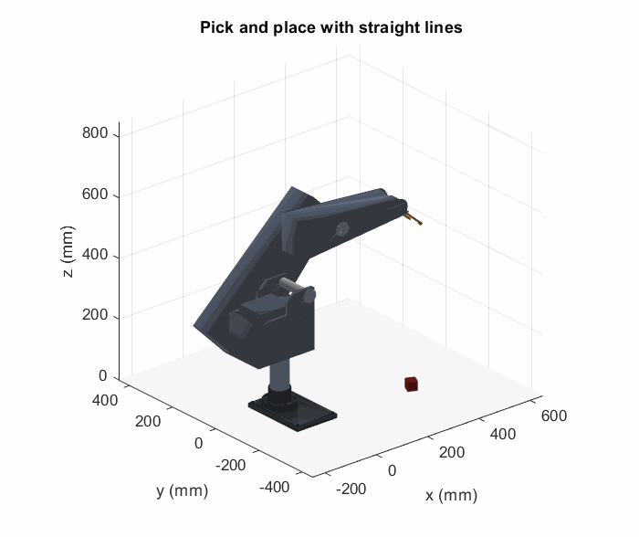
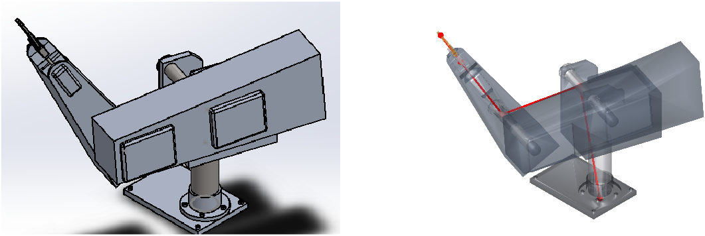
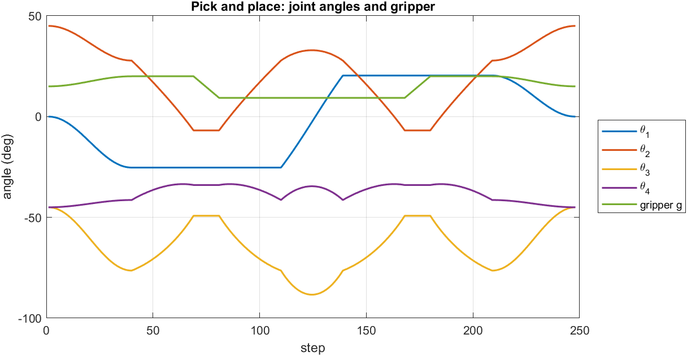
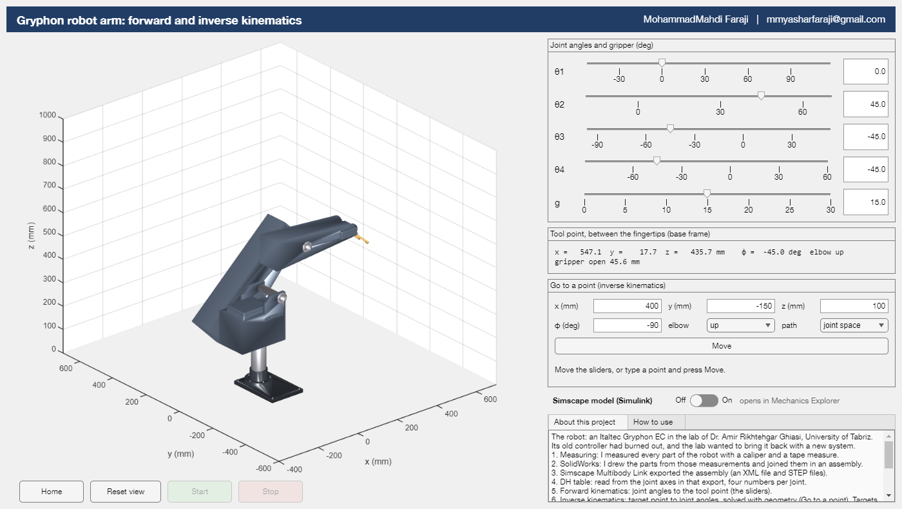
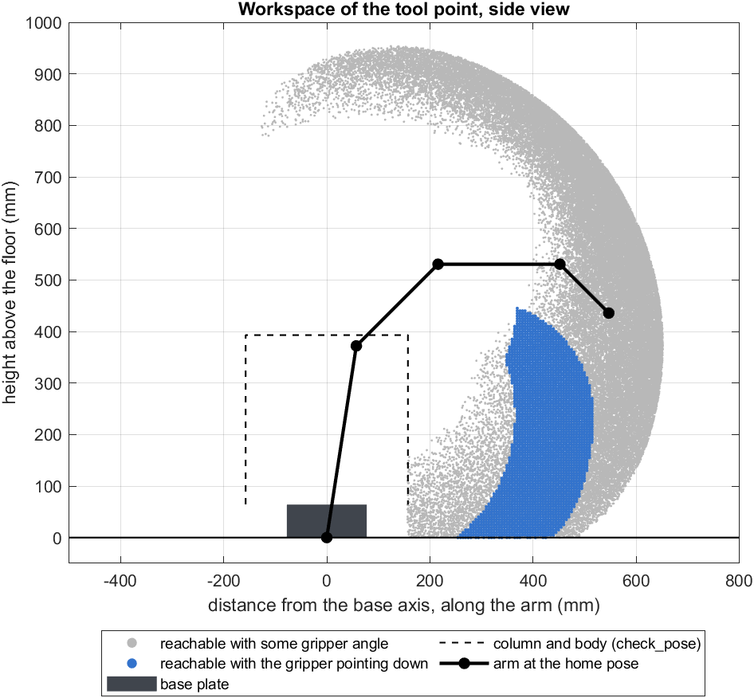

# Gryphon robot arm: measured by hand, drawn in SolidWorks, moved with kinematics in MATLAB

**Author:** MohammadMahdi Faraji

The Gryphon EC is a small five-axis robot arm made by Italtec for teaching. One of them stands in the lab of Dr. Amir Rikhtehgar Ghiasi at the University of Tabriz. Its old controller and computer had burned out, and the lab wanted to bring it back with a new control system and a much better accuracy. To start, I measured every part of the robot with a caliper and a tape measure and drew it in SolidWorks. This repository turns that drawing into a working model: the math between joint angles and gripper position, a Simscape model built from the same CAD files, and a window to move the robot with sliders or by typing a target.

<p align="center"></p>
<p align="center"><sub>The robot picks up a 30 mm block and puts it down 320 mm further on, with the gripper pointing straight down. The moves down, up and across are straight lines, and every point of them is solved with inverse kinematics.</sub></p>

## Quick start

Download the repository (Code > Download ZIP), unzip it and double-click **`click_to_fast_start.bat`** (Windows, MATLAB needed). MATLAB starts, and then the window of the robot opens.

On other systems, open `click_to_fast_start.m` in MATLAB and press Run. MATLAB can take a minute to start, and Windows may ask once before it runs a file from the internet.

## What this project is about

A robot arm is a chain of links joined by motors. The motors only know angles: "turn 30 degrees". But the job is almost always described as a place: "put the gripper on that block". So there are two questions, and they go in opposite directions.

- **Forward kinematics:** if the joints have these angles, where is the gripper? You walk along the arm link by link: "go up 372 mm, step 57 mm forward, turn, go 224 mm along the upper arm...". At the end of the walk you know where you are.
- **Inverse kinematics:** I want the gripper here, so what angles do I need? This is the hard one. Some points can't be reached at all. Some can be reached in two ways (elbow up or elbow down). And a joint may not be able to turn far enough.

Both need the exact dimensions of the robot, and for an old robot without drawings those have to be measured. This was the final project of my Mechatronics course: the measurements, the SolidWorks model and a first Simscape model with sliders. For this repository I checked those files again, fixed the assembly, exported it again, and wrote the kinematics, the window and the checks on top of it. [docs/changes_from_course_project.md](docs/changes_from_course_project.md) lists what was wrong in the first version and what is new.

The model has the waist, the shoulder, the elbow, the wrist pitch and the two-finger gripper. The real robot also has a wrist roll (the gripper turning about its own axis), which is not in this model.

## At a glance

| | |
|---|---|
| Robot | Italtec Gryphon EC ([data sheet](https://www.italtec.it/docpdf/engryple.pdf)), lab of Dr. Amir Rikhtehgar Ghiasi, University of Tabriz |
| Modelled | 4 revolute joints (waist, shoulder, elbow, wrist pitch) and a two-finger gripper. The wrist roll is not modelled |
| Size | shoulder 372 mm above the floor and 57.3 mm in front of the waist axis, links 224.2 and 236.5 mm, 134.1 mm from the wrist to the tool point |
| Reach | up to 652 mm from the base axis, up to 954 mm high |
| CAD | SolidWorks, 8 parts drawn from caliper and tape measurements |
| Software | MATLAB R2024b, Simulink, Simscape Multibody, SolidWorks 2022 with Simscape Multibody Link 7.4 |
| Inverse kinematics | closed form (geometric), gripper angle as input, elbow up or down |

## Results

There are three independent ways to find the tool point (half way between the fingertips), and they agree:

| check | difference |
|---|---:|
| forward kinematics vs the tool point in the SolidWorks file | 0.001 mm |
| forward kinematics vs the Simscape model (its own sensor), 8 poses | 0.0010 mm |
| fingertips from `gripper.m` vs the Simscape model, the same 8 poses | 0.0018 mm |
| inverse kinematics, then forward kinematics again, 20000 random poses | about 1e-12 mm |

The Simscape model is the independent check. It is built only from the CAD export and does not use my DH table, only a sign and an offset per joint to turn my angles into its own. Sensors in the model measure the tool point and both fingertips, so a mistake of even one millimetre in the table would show up there.

These numbers say that the math matches the CAD model. How well the CAD model matches the real robot depends on my measurements, and that has not been checked on the robot yet.

`matlab/check_kinematics.m` runs all the checks, including targets that must be refused (too far, on the base axis, under the floor, into the base, behind the robot), and writes [results/kinematics_check.txt](results/kinematics_check.txt).

## How it works

### 1. From the robot to a CAD model

<p align="center"></p>
<p align="center"><sub>Left: the SolidWorks assembly. Right: the same STL parts in MATLAB, placed on the DH frames (red line), in the pose of the CAD file.</sub></p>

I measured the parts with a caliper and a tape measure and drew eight of them in SolidWorks: base plate, column, body, upper arm, forearm, hand, finger (used twice) and the shaft of the shoulder and elbow (used twice). In the assembly every joint is a mate between two parts. Simscape Multibody Link exports the assembly as an XML file, which lists where each part sits and where every joint axis is.

### 2. The DH table

Four numbers per joint, all read from the joint axes in that XML file.

| link | a (mm) | alpha | d (mm) |
|---|---|---|---|
| 1 | 57.3 | 90 | 372 |
| 2 | 224.159 | 0 | 0 |
| 3 | 236.475 | 0 | 0 |
| 4 (gripper) | 134.104 | 0 | -17.723 |

Two details:
- **The shoulder is not above the waist axis.** It sits 57.3 mm in front of it, so a1 is not zero.
- **The gripper is 17.7 mm to the side.** Seen from above, the body, the upper arm and the forearm sit side by side, and the tool point ends 17.7 mm beside the plane of the arm.

[docs/dh_parameters.md](docs/dh_parameters.md) shows where each number comes from, part by part.

### 3. Forward kinematics

Each line of the table becomes a 4x4 matrix, and multiplying the four matrices gives the position and direction of the gripper (`forward_kinematics.m`).

### 4. Inverse kinematics

`inverse_kinematics.m` solves it geometrically, in four steps:

1. **Waist angle.** Seen from above, the arm has to turn towards the target. Because the tool point is 17.7 mm to the side, it does not point exactly at the target.
2. **Wrist point.** You also give the gripper angle (`phi`, for example -90 for "pointing down"). If you know where the tool point must be and which way the gripper points, you can step back 134.1 mm along the gripper and find the wrist.
3. **Shoulder and elbow.** The upper arm, the forearm and the line from the shoulder to the wrist form a triangle with three known sides. The law of cosines gives the elbow angle. The triangle can be folded two ways: "elbow up" and "elbow down".
4. **Wrist angle.** Whatever is left of the gripper angle goes to the wrist.

Then `check_pose.m` makes sure the answer is allowed: every joint stays within its limits, the gripper stays above the floor, and it stays out of the base plate, the column and the body.

### 5. The gripper

The two fingers turn about their own pins, in opposite directions. `gripper.m` takes the gripper angle `g` (0 = closed, as in the CAD file) and gives the fingertips: 6.2 mm apart when closed, 30 mm at g = 9.3, and 85 mm when fully open at g = 30.

### 6. Straight lines and pick and place

If you only interpolate the angles, the gripper moves on a curve. For a straight line, `plan_line.m` solves the inverse kinematics at many points along the line (60 by default, and about one point every 6 mm in the window). It stops if a joint would jump between two neighbouring points, which happens near a singular pose. `pick_and_place.m` uses it for the demo at the top of this page.

<p align="center"></p>
<p align="center"><sub>Joint angles and gripper during the pick and place demo. To keep the tool point on straight lines, the angles change in a non-linear way.</sub></p>

### 7. The Simscape model

`simulink/make_model.m` imports the SolidWorks export (XML plus STEP files) with `smimport`, then adds:
- **An angle input for every joint.** The Simscape joints measure their angles from the CAD mates, not from the DH zero, so a sign and an offset convert one into the other. Both fingers get the gripper angle, each with its own sign.
- **Sensors between the floor and the tool point, and between the floor and each fingertip.** These are the checks from the Results section.

## The window

<p align="center"></p>

`arm_gui.m` opens a window with the real CAD parts in 3D. You can:
- move each joint and the gripper with a slider or type the angle; the tool point and the gripper opening are shown below
- type a target point and a gripper angle, choose elbow up or down, and press Move
- choose a joint space path (curved) or a straight line; the red line shows the path of the tool point
- press Stop to hold the robot where it is, even in the middle of a move, and Start to go on to the same target
- press Home to go back to the home pose from any state, and Reset view after zooming or turning the 3D view
- turn on the "Simscape model" switch: the Simscape model starts in Mechanics Explorer and follows every move made in the window (the first start takes about half a minute)
- read "About this project" at the bottom right: the whole project, from measuring to the checks, in eight short steps

If a target can't be reached, the window says why, for example "joint 2 would need -24.5 deg (limit -19.3 to 70.7)". A joint space move is also refused when both ends are fine but a pose on the way would go under the floor or into the base.

## Workspace

<p align="center"></p>
<p align="center"><sub>Where the tool point can go, seen from the side. Grey: reachable with some gripper angle. Blue: reachable with the gripper pointing straight down, which is what you need to pick things up from a table.</sub></p>

With the gripper pointing down, the robot can reach from 254 to 515 mm in front of the base axis, from the table up to 445 mm high.

## How to run

You need MATLAB (tested with R2024b). Simscape Multibody is only needed for the Simulink model and for part 2 of the checks. Besides `click_to_fast_start`, from the MATLAB command window:

```matlab
cd matlab
arm_gui            % the window
check_kinematics   % all the checks, results/kinematics_check.txt
plot_workspace     % results/figures/workspace.png
pick_and_place     % the demo, media/pick_and_place.gif
```

The model in `simulink/gryphon_arm.slx` is ready to open. After changing the CAD, export it again with the Simscape Multibody Link add-in (Tools > Simscape Multibody Link > Export > Simscape Multibody) and run `simulink/make_model.m` to rebuild the model. If you export the STL meshes again, export them in millimetres and turn on "Do not translate STL output data to positive space", so that every mesh stays in the frame of its part.

## Repository layout

```
click_to_fast_start.bat / .m   open the window with one click
cad/            SolidWorks parts and the fixed assembly, cad/stl/ the meshes used for drawing
simulink/       the SolidWorks export (gryphon.xml + STEP), make_model.m, gryphon_arm.slx
matlab/         kinematics, checks, demo and the GUI
  robot_params.m        DH table, joint limits, home pose, gripper, numbers for the Simulink model
  forward_kinematics.m  angles -> tool point
  inverse_kinematics.m  tool point -> angles
  check_pose.m          joint limits, floor and base
  gripper.m             the two fingers for a gripper angle
  plan_line.m           straight line paths
  load_arm_parts.m, draw_arm.m   draw the real parts in 3D
results/        kinematics_check.txt and figures
media/          GIF and pictures for this page
docs/           the DH table explained, changes since the course version
legacy/         the original course files
```

## Limitations

- **The model comes from hand measurements.** I measured the robot with a caliper and a tape measure, and some dimensions carry a small error. The model has not been compared with the real robot yet (for example by moving the real joints and measuring where the gripper goes).
- **No wrist roll.** The real Gryphon EC has a fifth axis that turns the gripper about its own axis. The model leaves it out, so the gripper can only close across the arm, not along it.
- **The joint limits are not from the real robot.** They are the slider ranges of my course model. The limits of the real joints should be measured before the model is used with the robot.
- **The masses are not real.** The parts are drawn as solid blocks with real materials (aluminium and steel), which gives 51.4 kg in total. The real links are not solid, so the masses and the torques that the Simscape model computes are not realistic.
- **The base check is simple.** It only looks at the wrist and the tool point and treats the base as a box and a cylinder. It does not check the thickness of the links, so the forearm could still touch the body in some poses.
- **The motion is kinematics only.** Paths have no timing, speed or torque limits.

## Thanks

- Dr. Amir Rikhtehgar Ghiasi and his lab at the University of Tabriz, for the chance to work on their robot.
- I used an AI assistant to help review and rewrite the code, to clean it up and prepare it for publishing.

## License

MIT, see [LICENSE](LICENSE).
